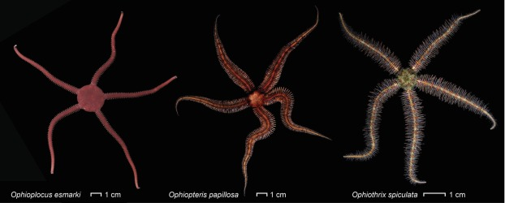
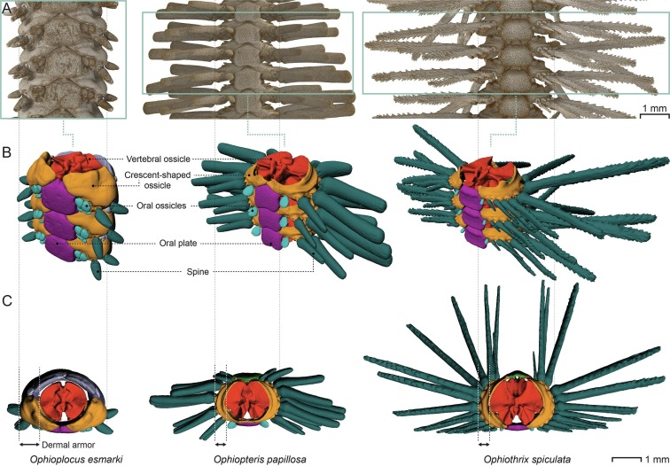
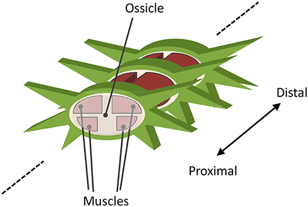
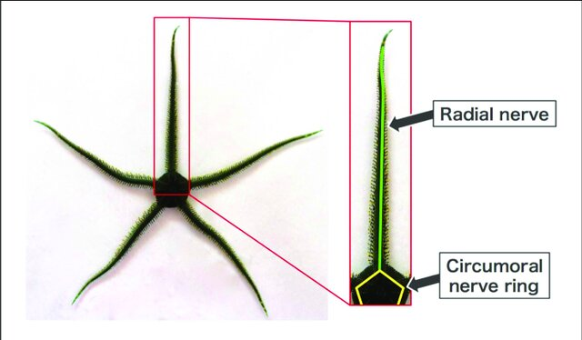
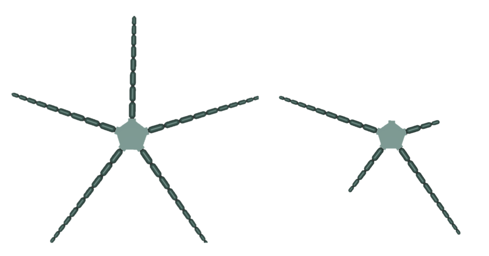
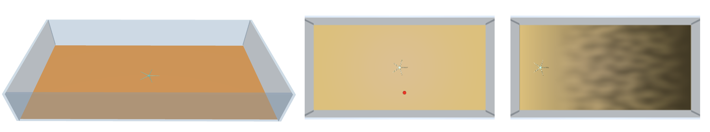

# The Brittle Star Environment

> “The whole of the brittle stars are curious and restless beings. They can never remain in the same attitude for the
> tenth part of a second, but are constantly twisting their long arms, as if they were indeed the serpents with which
> Medusa’s head was surrounded.” -- J. G. Wood, 1898

The brittle star environment within the Bio-Inspired Robotics Testbed (BRT) presents an intriguing case study,
embodying the intersection of natural biological systems and robotic engineering. To introduce this environment, it's
essential to first understand the biological entity that inspired it: the brittle star.


(Image src: https://doi.org/10.1016/j.jsb.2020.107481)

## The Brittle Star

Brittle stars, belonging to the class Ophiuroidea, are remarkable echinoderms distinguished by their distinctively
slender arms and central disk. They inhabit various marine environments, showcasing a fascinating array of behaviors and
adaptations that have captivated biologists for decades. One of the most striking features of brittle stars is their
locomotion. Unlike their close relatives, the starfish, brittle stars move with a unique, elegant undulating motion of
their arms. This locomotion is not only efficient but also highly adaptable, allowing them to navigate complex
underwater terrains with agility and precision.

In addition to locomotion, brittle stars use their arms to hold onto substrates, coiling their flexible arms tightly
around structurally complex objects such as kelp, sponges, or corals, with spines located along the arms aiding in the
anchoring process.

From an evolutionary standpoint, brittle stars represent a significant lineage, offering insights into the adaptability
and resilience of marine life. Their ability to regenerate lost limbs and their sensory capabilities, which include
responding to light without distinct eyes, are just a few examples of their remarkable biological traits. These
characteristics make them an excellent subject for bio-inspired robotics, as they provide a template for designing
robots that are both flexible and resilient, capable of navigating and adapting to diverse environments.

### Morphology


(Image src: https://doi.org/10.1016/j.jsb.2020.107481)

At the core of a brittle star's anatomy is the central disk, which varies in size from as small as 3mm to as large as
50mm. This disk is not just a structural component but also serves as a crucial hub for the organism's nervous system
and, in some species, reproductive organs.

Brittle stars possess five arms that are symmetrically arranged in a pentaradial fashion around the central disk. This
pentaradial symmetry is a hallmark of echinoderms and is crucial for the brittle star's locomotion and interaction with
its environment. These arms typically span about two to twenty times the diameter of the central disk. In terms of
mobility, the arms of brittle stars are capable of both in-plane and out-of-plane bending.

Structurally, each arm consists of a chain of segments, each one consisting out of a vertebra and 4 muscle groups and
completely enclosed by plates. This skeletal structure provides both support and flexibility, enabling the arms to move
fluidly while maintaining structural integrity.


(Image src: https://doi.org/10.3389/fnbot.2019.00104)

Lastly, the arms of brittle stars are adorned with soft spines. These spines play a crucial role in anchoring and
interacting with the environment. They provide stability and traction on various surfaces, aiding in locomotion and
foraging activities.

For an interesting read w.r.t. brittle star
morphology: [The structural origins of brittle star arm kinematics: An integrated tomographic, additive manufacturing, and parametric modeling-based approach](https://www.sciencedirect.com/science/article/pii/S1047847720300447)

### Nervous system


(Image src: http://dx.doi.org/10.3389/fnbot.2019.00066)

The nervous system of the brittle star is a fascinating aspect of its biology, characterized by its decentralized
nature. This decentralized nervous system is quite different from the central nervous systems found in vertebrates and
even some invertebrates. In brittle stars, the nervous system is primarily composed of a nerve ring that encircles the
central disk, from which branches extend into each arm.

The nerve ring acts as a central hub, integrating sensory inputs and coordinating the movements of the arms. Unlike
centralized nervous systems where a brain or a similar central organ exerts control, the nerve ring in brittle stars
does not function as a central command center. Instead, it serves more as a conduit or a relay station, facilitating
communication across the organism's body.

From this nerve ring, nerve branches run along each arm, allowing for localized control and sensory perception within
each limb. This structure is crucial for the brittle star's survival, as it enables each arm to react independently to
stimuli. For instance, if one arm encounters a predator or a harmful stimulus, it can respond immediately and
appropriately, without the need for centralized processing.

### Behavioural studies

Several modes of locomotion have been observed in brittle star species, with one species often exhibiting multiple
modes. A common mode is the ['breast stroke' or 'rowing'](https://www.youtube.com/watch?v=X8UEST-flCM), where the
brittle star moves forward led by an arm, uses two lateral arms as rowers, and drags the remaining two arms passively.
This mode is documented in various studies. Another mode, known as 'paddling' or 'reverse rowing,' involves dragging the
rearmost arm while the other four arms actively row. These modes, which involve bilaterally coordinated movements, allow
the brittle star to crawl in a specific direction. However, as the role of each arm changes with the direction of
movement, brittle stars do not maintain fixed front-back and left-right axes.

The following biological works provide valuable insights into the behavior and control mechanisms of brittle stars,
which provides a source of inspiration for their artificial counterpart. Here's a summary of each paper's findings:

- **Flexible coordination of flexible limbs: decentralized control scheme for inter- and intra-limb coordination in
  brittle stars’ locomotion**
    - Brittle stars display distinct roles for their arms: forelimbs, hindlimbs, and a center limb. This specialization
      allows for effective locomotion.
    - When all arms are shortened, brittle stars maintain their inter-arm coordination pattern, similar to when they are
      intact.
    - If some arms are removed, they still move effectively by coordinating the degrees of freedom in the remaining
      arms.
    - In the presence of obstacles, arms either push against objects to assist propulsion or avoid objects that hinder
      propulsion.
    - An arm completely detached from its disc is incapable of coordinated locomotion, indicating the importance of the
      proximal ends of the arms in the central disk for locomotion.
- **The function of the ophiuroid nerve ring: how a decentralized nervous system controls coordinated locomotion**
    - Nerve cut experiments reveal that the longest axons in the circumoral nerve ring do not extend beyond a fifth of
      its total length, suggesting limited direct connections between distant nodes.
    - Coordinated locomotion persists even with a single nerve ring cut, implying bidirectional connections between
      adjacent arms.
    - Arms adjacent to a nerve cut are less likely to lead in locomotion, suggesting that leading arms are those with
      better information propagation capabilities.
- **Decentralized Control Mechanism for Determination of Moving Direction in Brittle Stars With Penta-Radially Symmetric
  body**
    - When the nerve ring is cut in one place, movement tends to be in the opposite direction of the cut, and
      coordination is maintained except for arms adjacent to the cut.
    - With two cuts in the nerve ring, only neurally connected arms coordinate, while disconnected ones do not.
    - Complete severance of nerve ring connections between arms results in a lack of coordination and thus no
      locomotion.
    - If the nerve ring is cut on both sides of the same arm, the neurally isolated arm does not coordinate with others,
      highlighting the role of sensory input in coordination.
- **A brittle star-like robot capable of immediately adapting to unexpected physical damage**
    - Amputation experiments show varying roles for arms: center limb for orientation, forelimbs for propulsion, and
      minimal role for hindlimbs.
    - If arms are amputated, the robot adapts by reassigning roles, like using remaining arms for reverse rowing or as a
      trailing arm.
    - With three arms removed and no adjacent arms remaining, the direction-orienting arm swings to pull the body
      forward, while other arms play minimal roles in propulsion.
    - If only one arm remains, it swings left and right to pull the body forward.
    - When ground contacts of the arms are deprived, the subjects lose coordination in their arms.

### What makes it interesting for robotics?

The brittle star presents an intriguing case study for robotics due to several key characteristics:

1. Adaptive Locomotion in Unpredictable and Unstructured Environments: Brittle stars excel at navigating through
   unpredictable and unstructured environments. Their ability to adapt their locomotion patterns in response to varying
   terrain and obstacles makes them an excellent model for developing robots that can operate effectively in complex and
   dynamic settings.
2. Prehensile Arms Enabling Manipulation: The arms of brittle stars are not only locomotive appendages but also
   prehensile, meaning they have the ability to grasp and manipulate objects, such as prey. This feature is highly
   valuable in robotics, offering insights into designing robotic limbs that can perform intricate manipulation tasks.
3. Robustness to Damage: Thanks to their modular and redundant design, brittle stars are highly robust to damage. Each
   arm can operate independently, which means that the loss or impairment of one arm does not significantly hinder the
   overall functionality. This characteristic is crucial for creating resilient robotic systems that can maintain
   operation even when parts of them are damaged.
4. Integration of Strength and Flexibility in Arms: The arms of a brittle star embody a unique combination of strength
   and flexibility. This integration is key to their versatile functionality, allowing for both powerful movements and
   delicate handling. Replicating this in robotics could lead to the development of robotic limbs that are both strong
   and dexterous, capable of performing a wide range of tasks.

## In-silico brittle star morphology

The in-silico brittle star is an abstract virtual twin, built with MuJoCo's `MjSpec` from a plain dataclass
specification ([`specification.py`](specification.py)). The model itself is built in [`morphology.py`](morphology.py)
and the aquarium it lives in in [`arena.py`](arena.py). The most important parameters are the number of arms and the
number of segments per arm:

```python
from biorobot.brittle_star import BrittleStarMorphology, default_brittle_star_morphology_specification

specification = default_brittle_star_morphology_specification(
    num_arms=5,                          # at most 5; arms sit at multiples of 72 degrees
    num_segments_per_arm=[3, 0, 4, 2, 0],  # one int for all arms, or one value per arm (0 removes an arm)
    use_p_control=False,                 # position servos: actions are target joint angles (rad)
    use_torque_control=True,             # motors: actions are joint torques (N m)
    use_tendons=False,                   # four tendons per segment instead of joint motors (torque control only)
    radius_to_strength_factor=150,       # actuator strength = factor * segment radius
    num_contact_sensors_per_segment=1,   # 1 touch sensor around the whole capsule, or N around its circumference
)
morphology = BrittleStarMorphology(specification)
morphology.export("brittle_star.xml")    # inspect with `python -m mujoco.viewer`
```

Every field of the specification (disk radius and density, per-segment radius, length and density, joint range,
stiffness, damping and armature, ...) can also be edited directly before building the morphology. By default, arms
taper linearly from a segment radius of 2.5 cm and length of 7.5 cm at the disk to 1.25 cm and 2.5 cm at the tip; the
disk has a diameter of 25 cm. Densities (1530 kg/m³ for the arms, 1270 kg/m³ for the disk) come from
[this paper](https://doi.org/10.1088/1748-3190/adbecb).


Two example in-silico brittle star morphologies.

Every segment has two degrees of freedom (DoF), an in-plane joint (±45°) and an out-of-plane joint (±30°). In terms of
actuation, the specification selects either position control (gain 20) or torque control. With torque control, it can
also use tendon-based transmission: four tendons per segment, similar to the muscle architecture of the brittle star
shown above. Tendons can only pull (actions in `[-strength, 0]`, with a gear of 15). Actuator strengths scale with the
segment radius, so the maximum force of an actuator decreases along the arm.

Once attached to an arena, all element names are prefixed with `BrittleStarMorphology/` (e.g.
`BrittleStarMorphology/arm_0_segment_2_in_plane_joint`), and the central disk gets a free joint
`BrittleStarMorphology/freejoint`. The actuators are ordered arm by arm, from the disk to the tip, with the in-plane
actuator before the out-of-plane one (or the four tendons of a segment).

## The aquarium

`AquariumArena(AquariumArenaConfiguration(...))` is a walled tank filled with water (density 1000 kg/m³, viscosity
0.0009 Pa s, which enables MuJoCo's drag and buoyancy model). Its options: `size` (floor half-extents, default
`(5, 3)` m), `sand_ground_color` (a flat sand-coloured floor that the light escape task paints its light map onto, with
`light_map_resolution` texels per half-extent, i.e. per 2 m: 25 texels per metre and a 150 × 250 light map by
default), `attach_target` (a red target sphere of radius 0.2 m, a mocap body so every
episode can move it), `wall_height` and `wall_thickness`. Camera 0 (`top_camera`) looks down on the whole tank,
camera 1 (`BrittleStarMorphology/side_camera`) follows the brittle star.

## Environments

The brittle star comes with three locomotion tasks that form a curriculum of increasing difficulty. Each one is
registered with `biorobot.make` and runs on three backends:

- `"mjc"`: MuJoCo (C, CPU, numpy). `state.data` is a `mujoco.MjData`.
- `"mjx"`: MuJoCo XLA (JAX): `jax.jit` and `jax.vmap` over `reset` and `step` work out of the box.
- `"warp"`: MJX with the MuJoCo Warp implementation (NVIDIA GPUs).

```python
import jax
import biorobot

env = biorobot.make("brittle_star/directed_locomotion", backend="mjx", simulation_time=10, render_mode="rgb_array")
state = jax.jit(env.reset)(jax.random.PRNGKey(0), target_position=jax.numpy.array([2.0, 1.0, 0.05]))
step = jax.jit(env.step)
while not (state.terminated or state.truncated):
    state = step(state, jax.numpy.zeros(env.action_space.shape))
frames = env.render(state)  # top and side camera
```

To use your own morphology, arena or configuration, build them explicitly:

```python
from biorobot.brittle_star import (
    AquariumArena,
    AquariumArenaConfiguration,
    LightEscapeEnv,
    BrittleStarMorphology,
    LightEscapeEnvConfig,
    default_brittle_star_morphology_specification,
)

morphology = BrittleStarMorphology(
    default_brittle_star_morphology_specification(num_arms=5, num_segments_per_arm=6, use_torque_control=True)
)
arena = AquariumArena(AquariumArenaConfiguration(sand_ground_color=True))
config = LightEscapeEnvConfig(light_perlin_noise_scale=10, simulation_time=20, color_contacts=True)
env = LightEscapeEnv.from_morphology_and_arena(morphology, arena, config, backend="mjc")

state = env.reset(0)
state = env.step(state, env.action_space.sample())
```

`biorobot.make(name, backend=..., morphology_specification=..., arena_configuration=..., config=..., **overrides)`
does the same, with a 5-armed, 5-segment, position-controlled brittle star (`radius_to_strength_factor=200`) and a
suitable aquarium by default; extra keyword arguments override config fields. With `"mjc"`,
`biorobot.core.gym.GymnasiumEnv(env)` turns an environment into a regular `gymnasium.Env`.

### Observations

Every task returns a dictionary with (sizes for a brittle star with S segments in total):

| Name | Size | Description |
| --- | --- | --- |
| `joint_position` | 2S | in-plane and out-of-plane joint angles (rad) |
| `joint_velocity` | 2S | joint velocities (rad/s) |
| `joint_actuator_force` | 2S | total actuator torque on each joint (N m) |
| `actuator_force` | 2S or 4S | scalar force of each actuator (4 per segment with tendons) |
| `disk_position` | 3 | position of the central disk in the world (m) |
| `disk_rotation` | 3 | extrinsic xyz Euler angles of the central disk (rad) |
| `disk_linear_velocity` | 3 | linear velocity of the central disk (m/s) |
| `disk_angular_velocity` | 3 | angular velocity of the central disk (rad/s) |
| `tendon_position` | 0 or 4S | tendon lengths (m), with tendon transmission only |
| `tendon_velocity` | 0 or 4S | tendon length velocities (m/s), with tendon transmission only |
| `segment_contact` | N·S | touch sensor values (N), N = `num_contact_sensors_per_segment` |

### Tasks

1. **Undirected locomotion** (`brittle_star/undirected_locomotion`, simple): move as far away from the origin as
   possible.
    - Reward per step: $d_{t} - d_{t-1}$, with $d$ the xy distance between the central disk and the origin.
    - Info: `time`, `xy_distance_from_origin`.
2. **Directed locomotion** (`brittle_star/directed_locomotion`, intermediate): move towards a target.
    - Reward per step: $d_{t-1} - d_{t}$, with $d$ the xy distance between the central disk and the target. The
      episode terminates when the disk is within the target's radius (0.2 m).
    - Requires an aquarium with `attach_target=True`.
    - Pass `target_position` (xyz) to `reset` to place the target. Without it (or with NaNs, which allows mixing
      both within a vmapped batch), the target is placed at a random angle at `target_distance` (default 3 m) from the
      origin, 5 cm above the floor.
    - Extra observations: `unit_xy_direction_to_target` (2) and `xy_distance_to_target` (1, m).
    - Info: `time`, `xy_target_position`.
3. **Light escape** (`brittle_star/light_escape`, hard): move into the dark. The light decreases linearly from bright
   (x = -5 m) to dark (x = +5 m); `light_perlin_noise_scale > 0` adds Perlin noise with that many periods along each
   axis (it must divide the light map size, 150 x 250 for the default arena; the starting zone stays noise free). The
   brittle star starts at x = -3.75 m.
    - Reward per step: $L_{t-1} - L_{t}$, with $L$ the body light income: the mean light at the disk and at every
      segment (bilinearly interpolated from the light map), weighted by their (projected) surface areas.
    - Requires an aquarium with `sand_ground_color=True`.
    - Extra observations: `segment_light_intake` (S) and `disk_light_intake` (1), both in [0, 1].
    - Info: `time`, `x_distance_travelled` (m) and `_light_map` (each episode has its own map, which is painted on
      the floor when rendering).

### Configuration

Besides the generic `EnvConfig` fields (`simulation_time`, `num_physics_steps_per_control_step`, `physics_timestep`,
`render_mode`, `render_size`, `camera_ids`, ...), every brittle star configuration has:

- `joint_randomization_noise_scale` (default 0): initial segment joint angles (rad) and velocities (rad/s) are sampled
  uniformly from `[-scale, scale]`.
- `random_initial_rotation` (default `False`): randomly rotate the brittle star around the z-axis on reset.
- `color_contacts` (default `False`): colour segments that touch something red when rendering.
- `solver_iterations=1`, `solver_ls_iterations=5`, `disable_eulerdamp=True`: fast solver settings that the tasks were
  tuned with (raise the iterations for more accurate contacts).

`DirectedLocomotionEnvConfig` adds `target_distance` and `LightEscapeEnvConfig` adds `light_perlin_noise_scale`.


From left to right: the undirected locomotion, the directed locomotion (target is the red sphere), and the light
escape (with light noise) environments.

### Examples

```shell
python -m biorobot.brittle_star.examples.undirected_locomotion --backend mjc --render human
python -m biorobot.brittle_star.examples.directed_locomotion --backend mjx --render human
python -m biorobot.brittle_star.examples.light_escape --backend mjc --render human
python -m biorobot.brittle_star.examples.rowing --backend mjc --render human        # open-loop two-armed rowing
python -m biorobot.brittle_star.examples.vectorized --backend mjx --render human    # vmapped light escape
```

Every example accepts `--render none` and `--num-steps N` to run headless.

## Publications

Papers that use the in-silico brittle star:

- **Decentralized neural dynamics and sensory constraints shape brittle star locomotion** (Marzougui et al.,
  [2026](https://doi.org/10.1098/rsif.2025.1347)): an in-silico brittle star with an artificial neural network that
  mirrors the arm-level ganglia shows how the ganglia act as distributed oscillators and how their coupling through the
  nerve ring synchronises the arms, much like central pattern generators. The code is at
  [Co-Evolve/brittle-star](https://github.com/Co-Evolve/brittle-star).
- **Stability-Driven CPG Design for More Effective Quality-Diversity in Evolutionary Robotics** (Pex et al.,
  [2026](https://doi.org/10.1145/3795095.3805096)): central pattern generator design for quality-diversity optimisation,
  with the brittle star as a test morphology.

## Citation

If you use the brittle star, please cite the paper that fits your use (and BRT, see the
[main README](https://github.com/Co-Evolve/brt#citation)):

```bibtex
@article{marzougui2026brittlestar,
  title = {Decentralized neural dynamics and sensory constraints shape brittle star locomotion},
  author = {Marzougui, Dries and Adriaens, Dominique and wyffels, Francis},
  journal = {Journal of The Royal Society Interface},
  volume = {23},
  number = {239},
  year = {2026},
  doi = {10.1098/rsif.2025.1347}
}

@inproceedings{pex2026cpg,
  title = {Stability-Driven {CPG} Design for More Effective Quality-Diversity in Evolutionary Robotics},
  author = {Pex, Matthias and Marzougui, Dries and wyffels, Francis},
  booktitle = {Proceedings of the Genetic and Evolutionary Computation Conference (GECCO '26)},
  pages = {115--124},
  publisher = {ACM},
  year = {2026},
  doi = {10.1145/3795095.3805096}
}
```
