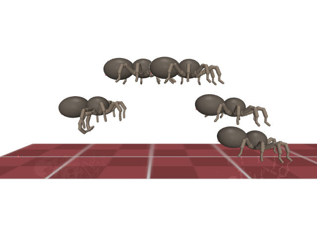
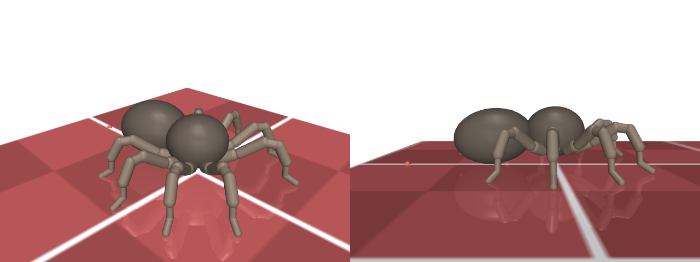
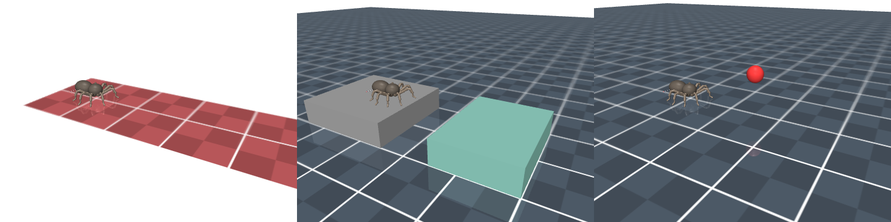

# The Jumping Spider Environment

Jumping spiders (Salticidae) hunt by sight and catch their prey with a precisely aimed jump. They plan the jump while
standing still, launch with their hind legs, fly ballistically while trailing a silk safety line, and land on their
front legs. The jumping spider environment of the Bio-inspired Robotics Testbed (BRT) turns this behaviour into a set
of benchmarks for the design and control of legged robots that have to jump, and into a controllable in-silico animal
for studying how morphology, actuation and the dragline shape a jump.


The in-silico jumping spider performing the scripted open-loop jump of `examples/scripted_jump.py` (composite of six
frames, 0.5-0.95 s; checker tiles are 10 cm).

## The Jumping Spider

With more than 6,000 described species, the salticids are the largest family of spiders. Unlike web-building spiders
they are active, diurnal hunters that stalk their prey and capture it with a jump, and many species also jump to cross
gaps between plants, to escape and during courtship. Their jumps are not stereotyped reflexes: the regal jumping
spider *Phidippus regius*, for instance, adapts its trajectory to the distance and height of its target (see below).

### Morphology

The body consists of two parts connected by a narrow, flexible stalk (the pedicel): the **cephalothorax** (prosoma),
which carries the eyes, mouthparts and the eight legs, and the **abdomen** (opisthosoma), which contains most of the
viscera and the silk glands and ends in the spinnerets. Each leg consists of seven segments: from the body outwards the
**coxa, trochanter, femur, patella, tibia, metatarsus and tarsus**. Leg pairs are numbered **I to IV** from front to
back (and as L1-L4 / R1-R4 per side). In salticids the front legs are typically robust and are used to grasp prey,
while the hind legs (III and IV) provide most of the thrust of a jump.

Spider legs lack extensor muscles at two joints: the femur-patella and the tibia-metatarsus joint. These joints are
flexed by muscles but extended by raising the pressure of the haemolymph (blood) in the legs, a hydraulic mechanism
first demonstrated by Parry and Brown ([1959a](https://doi.org/10.1242/jeb.36.2.423)).

### How jumping spiders jump

Before a jump the spider faces its target, attaches a silk line to the substrate and lifts its front legs. The jump is
powered by a rapid extension of the hind legs:

- Parry and Brown ([1959b](https://doi.org/10.1242/jeb.36.4.654)) filmed *Sitticus pubescens* and concluded that the
  sudden extension of the fourth legs, driven by a transient rise in haemolymph pressure, powers the jump.
- Nabawy et al. ([2018](https://doi.org/10.1038/s41598-018-25227-9)) trained a female *Phidippus regius* (150 mg, body
  length 15 mm) to jump across gaps of 2-5 body lengths and ±2 body lengths in height, filmed at 3,200 frames/s. The
  spider pushed off with leg pairs III and IV (leg III left the platform last) and kept legs I lifted for the landing.
  Take-off took 18-32 ms at take-off speeds of 0.52-0.97 m/s (accelerations of 1.7-5.4 g) and take-off angles of -10°
  to 54°. For short jumps it chose fast, low trajectories that minimise the flight time; for longer jumps it chose
  steeper trajectories closer to the energy-optimal one. The authors estimate that leg muscles alone can deliver the
  required power (~22 W per kg body mass), so hydraulics may augment, but is not essential for, the jump.

### The dragline as a stabiliser

Salticids pay out a dragline (safety line) while jumping. Chen et al.
([2013](https://doi.org/10.1098/rsif.2013.0572)) compared jumps of *Hasarius adansoni* with and without silk. The
spiders took off with a backward pitching rotation; spiders with silk could correct their body pitch in the air and
landed in 10 ± 2 ms, whereas spiders without silk landed with their head tilted ~41° more, needed 51 ± 29 ms to land and
sometimes slipped or tumbled. Silk and air drag together dissipated most of the jump's mechanical energy, with
comparable contributions; the silk force averaged about a quarter of the body weight, and the authors propose that the
spider controls it with a friction brake in its spinning apparatus. The silk is thus not only a safety line but also an attitude controller.

### Vision-guided targeting

Jumping spiders have eight eyes. The large, forward-facing **principal eyes** (anterior median eyes) have a long,
telescope-like optical system and a retina with four layers of photoreceptors; their highest resolution is about 11
arcmin (Land, [1969](https://doi.org/10.1242/jeb.51.2.443)). The secondary eyes detect motion and direct the principal
eyes towards targets. Nagata et al. ([2012](https://doi.org/10.1126/science.1211667)) showed that the spiders estimate
the distance to a target from the amount of defocus in one retinal layer: green-sensitive photoreceptors in a layer
where green light is always out of focus. Depth perception thus relies on the chromatic aberration of the lens, and
the distance that the spiders jump depends on the colour of the illumination.

### Behavioural studies

- **The hydraulic mechanism of the spider leg** (Parry & Brown, [1959a](https://doi.org/10.1242/jeb.36.2.423)):
  spider legs are extended at the femur-patella and tibia-metatarsus joints by haemolymph pressure, not by muscles.
- **The jumping mechanism of salticid spiders** (Parry & Brown, [1959b](https://doi.org/10.1242/jeb.36.4.654)): the
  jump of *Sitticus pubescens* is powered by the extension of legs IV; leg spines that erect at the moment of the jump
  give direct evidence of the involved pressure rise.
- **More than a safety line: jump-stabilizing silk of salticids** (Chen et al.,
  [2013](https://doi.org/10.1098/rsif.2013.0572)): the dragline is actively braked to control the body's pitch during
  the flight and to land quickly and upright.
- **Energy and time optimal trajectories in exploratory jumps of the spider *Phidippus regius*** (Nabawy et al.,
  [2018](https://doi.org/10.1038/s41598-018-25227-9)): the spider adapts the take-off angle and speed to the target,
  trading off flight time against energy.
- **Depth perception from image defocus in a jumping spider** (Nagata et al.,
  [2012](https://doi.org/10.1126/science.1211667)): the layered retina of the principal eyes measures distance from
  image defocus.

### What makes it interesting for robotics?

1. **Precise, targeted jumping**: a small legged system that reaches a target several body lengths away with a single
   ballistic jump, choosing its trajectory (fast and flat, or efficient and steep) depending on the target.
2. **Mixed actuation**: muscles flex the legs, hydraulics extend them. This combination is a template for robots that
   pair lightweight limbs with a centralised pressure source.
3. **Attitude control with a tether**: the dragline shows how a passive, brakeable tether can stabilise a body in
   flight and dissipate energy for a safe landing, without aerodynamic surfaces or a tail.
4. **A complete perception-action loop**: vision-based distance estimation, a preparatory posture and a launch that
   must succeed at the first attempt.
5. **Many degrees of freedom**: eight legs with seven segments each make it a challenging, high-dimensional control
   problem with strongly coupled take-off, flight and landing phases.

## In-silico jumping spider morphology


The default in-silico jumping spider.

The morphology is built with `mujoco.MjSpec` from a plain dataclass specification
(`biorobot/jumping_spider/specification.py`); `default_jumping_spider_morphology_specification(dragline=False,
position_control=True)` returns the default. All parameters can be changed before building the morphology:

```python
from biorobot.jumping_spider import JumpingSpiderMorphology, default_jumping_spider_morphology_specification

specification = default_jumping_spider_morphology_specification(dragline=True)
specification.legs[3].segments[2].torque_limit *= 1.5  # stronger femora in legs IV
morphology = JumpingSpiderMorphology(specification)
morphology.export("jumping_spider.xml")  # inspect with `python -m mujoco.viewer`
```

**Scale and units.** All quantities are in SI units. The model is a **1:10 scale** jumping spider: the body is 13.2 cm
long (a 15 mm *P. regius* scaled by ten) and gravity is not scaled. It therefore behaves like a 13 cm legged robot with a
salticid body plan rather than like a dynamically similar miniature; gram-scale spiders cannot be simulated stably at
practical timesteps. Masses follow from a single uniform density of 1000 kg/m³:

| Part                      | Shape                                                     | Mass     |
|---------------------------|-----------------------------------------------------------|----------|
| Cephalothorax             | ellipsoid, half-sizes 30 × 30 × 25 mm                     | 94 g     |
| Abdomen                   | ellipsoid, half-sizes 40 × 33 × 28 mm                     | 155 g    |
| One leg (7 segments)      | capsules, see below                                       | 8.9 g    |
| **Total**                 |                                                           | **320 g** |

The ellipsoids only provide mass and appearance; contacts use capsules inscribed in them (MJX has no ellipsoid-box
collisions). Only contacts between the spider and the arena are simulated.

**Legs.** The four leg pairs attach to the cephalothorax at 30°, 63°, 97° and 130° from the forward axis, 40° below its
equator. Every leg has the same seven segments, with literature-based proportions, resting angles and ranges of
motion:

| Segment    | Length (mm) | Radius (mm) | Mass (g) | Torque limit (N m) | Out-of-plane range (°) | In-plane range (°) |
|------------|-------------|-------------|----------|--------------------|------------------------|--------------------|
| coxa       | 11.6        | 5.85        | 2.09     | 0.80               | -13 to 39              | ±17.5              |
| trochanter | 6.8         | 4.15        | 0.67     | 0.40               | 0 to 60                | ±35                |
| femur      | 24.6        | 5.13        | 2.60     | 0.62               | -46 to 56              | -                  |
| patella    | 12.7        | 4.25        | 1.04     | 0.42               | -40 to 107             | -                  |
| tibia      | 17.6        | 4.70        | 1.66     | 0.52               | -20 to 0               | ±35                |
| metatarsus | 14.3        | 2.75        | 0.43     | 0.18               | -96 to 27              | ±7.5               |
| tarsus     | 11.8        | 2.85        | 0.40     | 0.19               | -31 to 91              | ±32.5              |

Each segment has an out-of-plane joint and, except for the femur and patella, an in-plane joint: 12 joints per leg and
96 leg joints in total. The abdomen adds a 2-DoF pedicel joint (±45° yaw and pitch). Joint conventions are the same for
all legs on both sides: a positive out-of-plane angle flexes the segment downwards, a positive in-plane angle swings it
backwards, and ranges are always `(lower, upper)`. A positive abdomen pitch raises its tip. Torque limits scale with the
squared segment radius (muscle cross-section); 0.8 N m at the coxa lets the 320 g model jump several body lengths.

Every joint has a small passive stiffness (5 mN m/rad towards the resting pose), damping (2 mN m s/rad) and armature
(2·10⁻⁵ kg m², i.e. a reflected rotor inertia): the leg segments weigh less than a gram and would otherwise be too fast
to integrate.

**Actuation.** One actuator per joint (98 in total), either

- position servos (default): actions are joint angle targets (rad) within the joint ranges. The servo gain is chosen
  such that a servo saturates at its torque limit for an error of 0.25 rad (`saturation_error`), with a damping ratio
  of 0.3; or
- torque motors (`position_control=False`): actions are joint torques (N m) within the torque limits.

Actions pass through a first-order low-pass filter with a 10 ms time constant (`activation_time_constant`, cf. muscle
activation dynamics). Together with the 1 ms physics timestep, it keeps the simulation stable even under saturated
(bang-bang) actions, which RL policies with squashed or clipped outputs produce often: without them, actions that switch
every control step whip the leg segments around and spin the airborne body until the simulation diverges. In a sweep
of 100 episodes per task and control mode, with and without joint noise, neither uniformly random nor bang-bang actions
made any episode diverge.

**Dragline.** With `dragline=True`, a spatial tendon connects the spinnerets (rear underside of the abdomen) to a
`dragline_anchor` site behind the start position in every arena. Spiders pay out silk freely but can brake its release,
so the dragline has a brake actuator (the last action, in [0, 1]) that acts as a damper on the tendon's lengthening
(`force = -5 N s/m * action * velocity`) and can only pull, with at most 5 N.

**Sensors and observations.** Every environment returns the following observations (a dictionary):

- Proprioception
    - `leg_joint_position` (96, rad, clipped to the joint ranges), `leg_joint_velocity` (96, rad/s),
      `leg_actuator_force` (96, N m)
    - `abdomen_joint_position` (2), `abdomen_joint_velocity` (2), `abdomen_actuator_force` (2)
    - `cephalothorax_position` (3, m), `cephalothorax_rotation` (3, extrinsic xyz Euler angles, rad),
      `cephalothorax_linear_velocity` (3, m/s), `cephalothorax_angular_velocity` (3, rad/s), all in the world frame
    - with a dragline: `dragline_length` (1, m), `dragline_velocity` (1, m/s), `dragline_brake_force` (1, N)
- Exteroception
    - `leg_tip_contact` (8, 0 or 1) and `leg_tip_contact_force` (8, N) from touch sensors on the tarsi

Legs are ordered L1, R1, L2, R2, ..., L4, R4; within a leg, joints go from coxa to tarsus with the in-plane joint
before the out-of-plane one. `env.actuator_names` lists the actions in order.

## Environment variants

```python
import biorobot

env = biorobot.make("jumping_spider/long_jump", backend="mjc")  # or "mjx" / "warp"
state = env.reset(0)  # a seed for mjc, a jax.random.PRNGKey for mjx/warp
state = env.step(state, env.action_space.sample())
```

With `backend="mjx"` (MuJoCo XLA, JAX) or `backend="warp"` (MuJoCo Warp, NVIDIA GPUs), `jax.jit(env.step)` and
`jax.vmap(env.reset)` work as usual and every batched environment samples its own gap or target. Factories accept
`config`, `morphology_specification`, `arena_configuration` and any field of the task's configuration as keyword
arguments (e.g. `simulation_time=5.0`, `render_mode="rgb_array"`, `color_contacts=True`).

All jumping spider environments share these configuration options (`JumpingSpiderEnvConfig`):

- `simulation_time` (default 3 s), `physics_timestep` (1 ms), `num_physics_steps_per_control_step` (10, i.e. 100 Hz
  control)
- `joint_randomization_noise_scale`: random initial joint angles within ± this value (rad); the spider is then lifted
  so that its lowest point starts just above the ground
- `min_flight_time` (0.1 s): a flight phase, i.e. no contact at all between the spider and the arena, of at least this
  duration counts as a jump
- `color_contacts`: colour leg tips that touch something red when rendering
- `camera_ids`: 0 = `top_camera`, 1 = `side_camera` (both fixed), 2 = the spider's tracking camera (default)

`state.info` contains `time`, `airborne`, `flight_time` (duration of the current flight phase) and `has_jumped`.
The spider always starts at the origin, facing +x, in its resting pose with its legs on the ground.


From left to right: the long jump, the platform jump and the directed jump (target in red), with a dragline.

1. **Long jump** (`"jumping_spider/long_jump"`): jump as far forward as possible on a flat track (2 m × 0.4 m, 10 cm
   tiles).
    - Reward per step: the forward (x) displacement of the cephalothorax (m). The return is the distance covered.
    - Terminated: when the spider lands after its first jump (`terminate_on_landing=True`), or when the cephalothorax
      leaves the track sideways (a failure).
    - Truncated: after `simulation_time`.
    - Additional observation: `x_distance` (1, m).
2. **Platform jump** (`"jumping_spider/platform_jump"`): jump from the start platform onto the end platform across a
   gap sampled uniformly from `gap_range` (default 0.1-0.25 m) every episode. Both platforms are 10 cm above the floor.
    - Reward per step: the decrease of the distance between the cephalothorax and the centre of the end platform's top
      surface (m), plus `success_bonus` (default 1) when the spider lands. Without the bonus, a jump that falls short
      can collect as much distance reward as a successful one.
    - Terminated: on success, when all eight leg tips touch the end platform, and on failure, when the cephalothorax
      falls `fall_depth` (5 cm) below the platforms. Failures terminate rather than truncate, so that value
      bootstrapping treats them as final.
    - Truncated: after `simulation_time`.
    - Additional observations: `unit_direction_to_end_platform` (3) and `distance_to_end_platform` (1, m).
    - Reset option: `env.reset(rng, gap=0.2)`.
3. **Directed jump** (`"jumping_spider/directed_jump"`): jump towards a target, like a salticid jumping onto prey. The
   target is placed at a distance from `target_distance_range` (default 0.2-0.4 m), an elevation from
   `target_elevation_range` (0-30°) and an azimuth from `target_azimuth_range` (0°) relative to the cephalothorax's
   start position.
    - Reward per step: the decrease of the distance between the cephalothorax and the target (m), plus `success_bonus`
      (default 1) on success.
    - Terminated: on success, when the centre of the cephalothorax is within the target sphere (radius 3 cm,
      `DirectedJumpArenaConfiguration.target_radius`) after a jump (`has_jumped`). Low targets can be reached by
      walking too, which earns the distance reward but neither the bonus nor termination.
    - Truncated: after `simulation_time`.
    - Additional observations: `unit_direction_to_target` (3) and `distance_to_target` (1, m).
    - Reset option: `env.reset(rng, target_position=[0.3, 0.0, 0.15])`.

The end platform and the target are mocap bodies, so their per-episode positions live in `state.data.mocap_pos`.

### Examples

```bash
python -m biorobot.jumping_spider.examples.long_jump --backend mjc --render human
python -m biorobot.jumping_spider.examples.platform_jump --backend mjx --render rgb_array
python -m biorobot.jumping_spider.examples.directed_jump --backend mjc --render none
python -m biorobot.jumping_spider.examples.scripted_jump --backend mjc --render human
```

The first three run random actions. `scripted_jump` runs an open-loop jump that shows that the model can jump: it
raises the abdomen and legs I-II while crouching on legs III-IV, then depresses and extends legs III and IV. On the long
jump track the spider takes off after ~0.56 s, is fully airborne for 0.39 s (apex 0.23 m) and lands upright on its legs
0.466 m further, i.e. ~3.5 body lengths, identically on mjc and mjx. The controller is available as
`biorobot.jumping_spider.examples.scripted_jump.scripted_jump_action(t, actuator_names)`.
