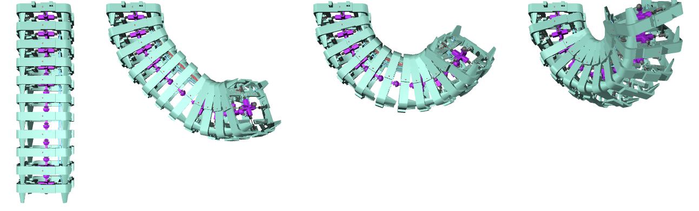

# The Seahorse Tail Environment

Seahorses hold on to seagrass, corals and each other with their prehensile tail. Unlike in any other fish, the
muscles of the seahorse tail form long, parallel sheets that span many vertebral segments. Marzougui et al.
([2025](https://doi.org/10.1098/rsif.2024.0876)) studied what this muscle architecture contributes to grasping with
an in-silico model of the tail, validated against a 3D-printed robotic prototype. This package contains that in-silico
tail, rebuilt on the BRT core.

Unlike the other BRT animals, the seahorse tail has **no task**: the reward is always 0 and the episode only ends when
time runs out. It is a playground for **muscle architectures**. You configure which muscles the tail has (how many
segments each long muscle spans, how it is routed, whether short intersegmental muscles are present, position or
force control, ...) through the morphology specification, and drive them with open-loop controls.


The default tail during the `examples/open_loop.py` controller, seen from its sinistral side (left to right: at rest,
after the distal MVM beams contracted (2.5 s), while the HM beams contract (3.5 s), and at 5 s). Contacts are disabled by
default, so parts can pass through each other.

## The Seahorse Tail

Seahorses (*Hippocampus*) anchor themselves with their tail, which lets them resist currents, cling to mates during reproduction and stay camouflaged from predators (Marzougui et al.
[2025](https://doi.org/10.1098/rsif.2024.0876)). Grasping tails evolved several times independently within the
syngnathids (seahorses, pipefishes, pipehorses and seadragons), but in different ways (Neutens et al.
[2014](https://doi.org/10.1111/joa.12181)).

### Morphology

The tail is a chain of segments. Each segment has a vertebra surrounded by **four bony plates** that together give the
tail a **square cross-section**. Plates of neighbouring segments are connected by sliding joints: a spine on one plate
glides in a furrow of the next one (Hale [1996](https://doi.org/10.1002/%28sici%291097-4687%28199601%29227:1%3C51::aid-jmor4%3E3.0.co;2-s);
Neutens et al. [2014](https://doi.org/10.1111/joa.12181)). Grasping bends the tail mainly ventrally, but it can also
bend laterally and twist a little. The plates get smaller towards the tip.

Porter et al. ([2015](https://doi.org/10.1126/science.aaa6683)) compared 3D-printed models of the square tail with a
hypothetical tail with a round cross-section. When crushed, the square plates slide past each other, which absorbs
energy and protects the spine. The square tail also has more contact points with a grasped object, while plate
interference limits twisting.

### Muscle architecture

Two groups of muscles bend the tail ventrally:

- **Hypaxial myomeres (HM)**: in pipefishes the myosepta (the connective-tissue sheets between muscle segments) are
  cone-shaped. In seahorses they are reorganised into long, **parallel sheets** that span several vertebral segments,
  up to eleven (Marzougui et al. [2025](https://doi.org/10.1098/rsif.2024.0876)). A tendon at their ventral side
  inserts on the plates (Neutens et al. [2014](https://doi.org/10.1111/joa.12181)). This parallel organisation is
  unique to seahorses; pipehorses grasp without it.
- **Median ventral muscles (MVM)**: short muscles that connect the haemal spines of neighbouring vertebrae. They are
  found in seahorses and in the pipehorse *Syngnathoides*, but not in pipefishes (Neutens et al.
  [2014](https://doi.org/10.1111/joa.12181)). Hale ([1996](https://doi.org/10.1002/%28sici%291097-4687%28199601%29227:1%3C51::aid-jmor4%3E3.0.co;2-s))
  proposed that the MVMs sustain holding while the hypaxial muscles power fast grasping.

### Findings of the paper

Marzougui et al. ([2025](https://doi.org/10.1098/rsif.2024.0876)) built a mechanical abstraction of a *Hippocampus
reidi* tail (vertebrae, gliding plates, HM and MVM muscles as cables), simulated it in MuJoCo and validated it against
a 3D-printed prototype. They found that:

1. HM muscles that **span more segments** produce **larger contraction forces** and convert contraction force into
   vertebral torque more efficiently;
2. the long HM muscles and the short, intersegmental MVMs play **complementary roles**;
3. the elongated muscle-tendon organisation therefore gives the seahorse tail a functional advantage for grasping.

The paper's code, CAD files and real-world measurements are in its repository,
[Co-Evolve/seahorse-muscle-architecture](https://github.com/Co-Evolve/seahorse-muscle-architecture), which also has
the original experiment scripts. You can also try muscle architectures in your browser in the
[Seahorse muscle playground](https://co-evolve.github.io/seahorse-muscle-architecture/).

### What makes it interesting?

1. **For biologists**: the tail is a controlled comparative method for muscle architecture. Change one muscle (its
   span, routing or control) while keeping the skeleton fixed, and measure its effect on bending and torque.
2. **For roboticists**: a tendon-driven, underactuated continuum manipulator, with a few long tendons for global
   curling and many short ones for local shaping. The mesh parts and their measured inertias come from a real
   3D-printed prototype.
3. **Armoured flexibility**: a stiff, protective exoskeleton of sliding plates that still allows large ventral bending.

## In-silico seahorse tail

The model is a digital twin of the printed prototype. Every part (vertebra, ball bearing, plates and their connectors)
is an STL mesh of the prototype (`assets/meshes`), with the measured mass and inertia of the printed part
(`assets/meshes/inertia.json`). All quantities are in SI units. With 11 segments, 32 mm apart, the tail weighs 542 g; a
plate weighs ~10 g, a vertebra 4.5 g and its ball bearing 2.1 g.

- **Vertebral joints**: every vertebra but the first (which is fixed to the world) has three hinges centred on the
  ball bearing between it and the previous vertebra: pitch (ventral bending, ±14°), roll (lateral bending, ±14°) and
  yaw (torsion, ±5°).
- **Gliding joints**: every plate except those of the first segment has two slide joints (5 mm travel, stiffness 1 N/m,
  damping 1 N s/m, friction loss 0.3 N). Joint equality
  constraints make neighbouring plates of a segment, and the corresponding plates of neighbouring segments, glide
  together.
- **Vertebral struts**: four elastic spatial tendons per segment connect the vertebra to its plates (3.043 N/m).
- **HM beams**: spatial tendons through attachment points (holes) on the plates. A beam starts at the "ghost"
  attachment points of its start segment. In every segment in between, it passes one of ten intermediate attachment
  points (0 is the most lateral, 9 the most medial one), and it ends on the plate of its end segment. HM beams are
  either force controlled (`p_control=False`; action in [-1, 0], times `f_control_gear` N, default 10 N) or position
  controlled (`p_control=True`; the action is a target length in [0, rest length] m, with a 1000 N/m gain and at most
  1000 N). Beams only pull.
- **MVM beams** (`mvm_enabled=True`): a pair of position-controlled tendons between every two neighbouring segments.
  The action is a target length in [`mvm_strain` × rest length, rest length] m. As in the original model, both beams of
  a pair attach to the ventral-sinistral plate, so contracting them also bends the tail sinistrally.

**Frames**: the tail hangs downwards (-z) from its base at the origin. Its ventral side faces +x and its sinistral
(left) side faces -y (world frame). Positive pitch bends the tail ventrally, negative roll bends it sinistrally.

### Configuring the muscle architecture

The specification (`biorobot/seahorse/specification.py`) is a set of plain dataclasses with the parameters and defaults
of the original model. `default_seahorse_morphology_specification(num_segments, hm_segment_span, p_control=True,
mvm_enabled=True, mvm_strain=0.0, hm_strain=0.0)` keeps the signature of the original. It creates no HM beams; add HM
routing specifications for those.

```python
from biorobot.seahorse import (
    HMMTendonRoutingSpecification,
    SeahorseMorphology,
    default_hm_routing_specification,
    default_seahorse_morphology_specification,
)

specification = default_seahorse_morphology_specification(
    num_segments=11, hm_segment_span=6, p_control=False, mvm_enabled=False
)
hm = specification.beam_actuation_specification.hm_beam_actuation_specification
hm.f_control_gear = 5.0  # maximum contraction force (N)
hm.routing_specifications = [
    # A ventral pair that spans the 6 most distal segments (the routing of the paper's HM experiment) ...
    default_hm_routing_specification(num_segments=11, segment_span=6),
    # ... and a single dorsal-dextral beam from segment 2 to 5 along the most lateral attachment points.
    HMMTendonRoutingSpecification(
        start_segment=2,
        end_segment=5,
        intermediate_points=[0, 0],
        sagittal_sides=["dorsal"],
        coronal_sides=["dextral"],
    ),
]
SeahorseMorphology(specification).export("seahorse_tail.xml")  # inspect with `python -m mujoco.viewer`
```

Every other parameter (joint ranges and passive properties, plate offsets, strut stiffness, beam damping and gains,
...) can be changed in the specification as well.

## Environment

```python
import biorobot

env = biorobot.make("seahorse/tail", backend="mjc")  # or "mjx" / "warp"
state = env.reset(0)
while not state.truncated:
    state = env.step(state, env.action_low)  # contract all beams fully
print(state.observations["vertebrae_pitch_joint_pos"])  # rad, base to tip
```

The default tail (`default_tail_morphology_specification()`) has 11 segments, a pair of force-controlled ventral HM
beams that span the whole tail, and 20 MVM beams. Pass `morphology_specification=...` for another architecture, e.g.
the one built above:

```python
env = biorobot.make("seahorse/tail", morphology_specification=specification)
```

- **Actions**: one per beam (`env.actuator_names`), HM beams first, then MVM beams. The upper end of every action range
  means relaxed and the lower end fully contracted.
- **Reward**: always 0. The episode never terminates and is truncated after `simulation_time`.
- **Observations**:
  - `vertebrae_{pitch,roll,yaw}_joint_pos` (num_segments - 1, rad)
  - `hm_beam_pos` and `mvm_beam_pos` (beam lengths, m)
  - `actuator_force` (always <= 0): the beam force in N under position control, or the beam force divided by
    `f_control_gear` under force control
  - `joint_actuator_force` (3 × (num_segments - 1)): the torque in N m that the beams exert on every pitch, roll and
    yaw joint

  Observations of absent beams are left out.

Configuration (`SeahorseTailEnvConfig`):

- `simulation_time` (5 s), `physics_timestep` (4 ms), `num_physics_steps_per_control_step` (10, i.e. 25 Hz control)
- `enable_contacts` (False): as in the original model, the convex hulls of the nested parts already overlap at rest (121
  geom pairs), so enabling contacts adds internal contact forces.
- `enable_gravity` (True): gravity pulls along the hanging tail, so it straightens again when its muscles relax (the
  original model had gravity off)
- `camera_ids`: 0 = `side_camera` (default), 1 = `corner`, 2 = `ventral`, 3 = `top-down`, 4 = `ventral-closeup`

**Stability**: position-controlled HM beams are stiff (1000 N/m, up to 1000 N). At the default 4 ms timestep they
can diverge, e.g. long spans under target jumps or ramps that saturate the beams. This happens in the original model
too, e.g. in the paper's HM experiment with a span of 10. Use a 1 ms timestep with
position-controlled HM beams (`physics_timestep=0.001, num_physics_steps_per_control_step=40`). Force-controlled HM
beams and MVM beams are stable at 4 ms, also under random and bang-bang actions.

**Backends**: without contacts, the model runs on all three backends and they agree (see below). With contacts, MuJoCo
Warp generates more contacts between the overlapping parts than MuJoCo C (~330 vs ~300 at rest), so the trajectories
drift apart (~0.05 rad within 1 s).

- **MJX**: on an M1 Max CPU, MJX compiles the default tail in ~20 s and runs ~600 physics steps per second for a single
  environment (2.4× real time). Its float32 joint angles match MuJoCo C to ~3e-3 rad (the gliding joints' dry friction amplifies round-off).
- **MuJoCo Warp**: also works. On a CPU it takes ~74 ms per control step and matches MuJoCo C to ~1e-6.

### Examples

```bash
python -m biorobot.seahorse.examples.open_loop --backend mjc --render human
python -m biorobot.seahorse.examples.muscle_architectures --backend mjc --render human
```

- `open_loop` drives the default tail. It first contracts the MVM beams of the four most distal segment pairs
  (0-2 s), then the HM beams (2.5-4.5 s), which curl the whole tail ventrally. The controller is
  `biorobot.seahorse.examples.open_loop.open_loop_action(env, t)`.
- `muscle_architectures` builds three other architectures and contracts each with the same ramp: a dorsal HM pair at
  the tip, a single lateral HM beam and an MVM-only tail. Once the dorsal pair has bent the tip to its pitch limits,
  the rising tension also rolls the tip sideways (~5 deg), because the dextral and sinistral attachment points of the
  original model differ by up to ~1 mm.

The experiments of the paper (force-to-torque measurements, HM spans, lateral bending, MVM recruitment and grasping a
cylinder) are not part of BRT; they are in the
[paper's repository](https://github.com/Co-Evolve/seahorse-muscle-architecture).

## Fidelity to the original model

The model was compared with the original implementation (dm_control MJCF, MuJoCo 3.2.2). The comparison covered 2- and
11-segment tails with position-controlled HM beams of spans 1, 2, 5, 6 and 10, force-controlled HM beams of span 10,
lateral routing (span 6) and MVM beams. Bodies,
masses, inertias, joints, tendons (attachment points in order, rest lengths), actuators, sensors, equality constraints,
cameras and lights are identical, with these exceptions:

- the principal inertias of the 70 mg vertebral connectors differ by up to 0.2%, because MuJoCo 3.17 diagonalises their
  nearly isotropic inertia tensors more accurately than 3.2.2;
- there is one mesh asset per STL file instead of one per part (no effect on the simulation);
- a `jointpos` sensor (and observation) is added for the yaw joints, which the original model created but did not
  sense;
- the original `segment_torque` observation is left out: the original model has no torque sensors, so it was always
  empty;
- the attachment frame is not a body;
- the gliding joints apply their specified friction loss (0.3 N), which the original model ignored, and have no
  armature;
- gravity is enabled by default (the original disabled it).

With the original's settings (no gliding-joint friction, no gravity), over 5 s the open-loop ramps of the paper's experiment scripts give vertebral angles within 5e-5 rad of the original
(MuJoCo 3.17 vs 3.2.2), except for the position-controlled HM beams of span 10 (with or without MVM beams), whose ramp
diverges after ~2.1 s in both versions. With contacts enabled, the trajectories differ by up to 0.2 rad, because MuJoCo 3.17 generates
more contacts between the overlapping mesh parts (300 vs 121 at rest).

## References

- **Exploring the evolutionary adaptations of the unique seahorse tail's muscle architecture through in silico
  modelling and robotic prototyping** (Marzougui et al., [2025](https://doi.org/10.1098/rsif.2024.0876)): the model of
  this package; HM muscles that span more segments give larger contraction forces and a more efficient force-to-torque
  conversion, and they complement the short MVMs.
- **Why the seahorse tail is square** (Porter et al., [2015](https://doi.org/10.1126/science.aaa6683)): the square,
  plated tail resists crushing and grips better than a round one.
- **Grasping convergent evolution in syngnathids: a unique tale of tails** (Neutens et al.,
  [2014](https://doi.org/10.1111/joa.12181)): plates, myosepta and MVMs of grasping and non-grasping syngnathid tails.
  The parallel myosepta are unique to seahorses.
- **Functional morphology of ventral tail bending and prehensile abilities of the seahorse, *Hippocampus kuda***
  (Hale, [1996](https://doi.org/10.1002/%28sici%291097-4687%28199601%29227:1%3C51::aid-jmor4%3E3.0.co;2-s)): sliding plate
  joints, multi-segmental myosepta and the role of the MVMs.

## Citation

If you use the seahorse tail, please cite the paper (and BRT, see the [main README](https://github.com/Co-Evolve/brt#citation)):

```bibtex
@article{marzougui2025seahorse,
  title = {Exploring the evolutionary adaptations of the unique seahorse tail's muscle architecture through
           in silico modelling and robotic prototyping},
  author = {Marzougui, Dries and Das, Riddhi and Mazzolai, Barbara and Adriaens, Dominique and wyffels, Francis},
  journal = {Journal of The Royal Society Interface},
  volume = {22},
  number = {226},
  pages = {20240876},
  year = {2025},
  doi = {10.1098/rsif.2024.0876}
}
```
